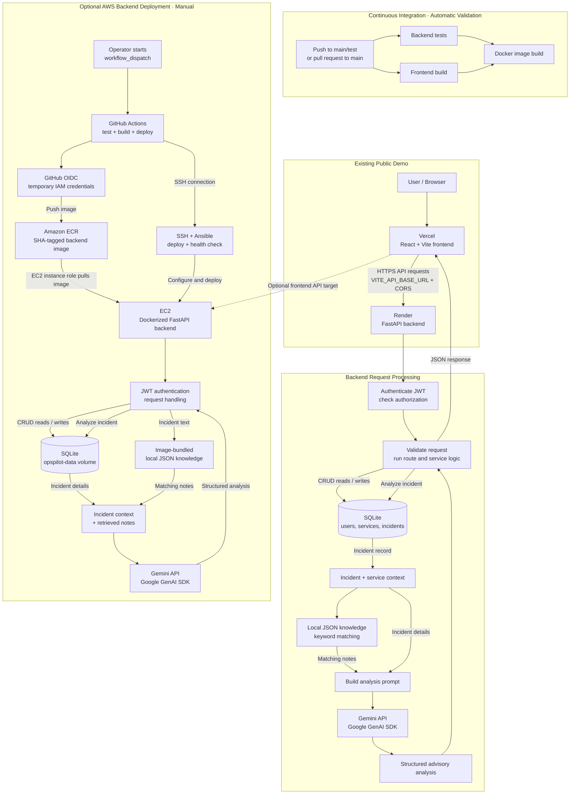

# OpsPilot

OpsPilot is a small incident and service-health management application for teams operating microservices. It provides a dashboard for recording service health, creating and tracking incidents, and requesting AI-assisted investigation suggestions.

## Project overview

The frontend is a React single-page application, and the backend is a FastAPI REST API. The backend validates requests, checks authentication and roles, and reads or writes users, services, and incidents in SQLite. When requested, it retrieves relevant entries from a local troubleshooting knowledge base and sends the incident context to Google Gemini for structured, advisory suggestions.

The existing public demo uses **Vercel for the frontend and Render for the backend**. A separate optional AWS path deploys the backend container to EC2. The AWS path is manually triggered; it is not continuous deployment.

## Features

- Register and log in; password hashes and JWT bearer tokens are managed by the backend.
- View service records and their recorded `healthy`, `degraded`, or `down` status.
- Admin users can create, edit, update status, and delete services.
- Authenticated users can create, view, filter, paginate, and update incidents.
- Incidents have a severity, status, affected service, and generated `INC`-style number.
- Request AI-assisted incident analysis with possible causes, suggested checks, and remediation ideas.
- Local keyword matching retrieves up to three relevant runbook entries for AI context.
- Seed six sample services and twelve fictional incidents for a demonstration.
- Store the backend database in SQLite; the deployment playbook mounts a persistent Docker volume.

## Architecture and deployment



The live demo and optional AWS path are separate hosting choices. Both use the same frontend/API configuration pattern: `VITE_API_BASE_URL` is embedded when Vite builds the frontend, and backend CORS (`ALLOWED_ORIGINS`) must allow the frontend's exact origin. SQLite operations happen inside backend request processing. The EC2 option mounts SQLite data at `/app/data` from the `opspilot-data` Docker volume; a volume is not a backup.

**Workflow status checked October 13, 2026:** GitHub Actions run [#7](https://github.com/sourabhjaishwal/opspilot/actions/runs/38222352771) reports success for the manually dispatched AWS workflow on October 12, 2026. The workflow has only a `workflow_dispatch` trigger. CI is separate and runs validation on configured pushes and pull requests; it does not deploy AWS. A successful workflow is evidence for that run, not proof that the public app or AWS resources remain reachable now.

### Technology

| Area | Technology |
| --- | --- |
| Frontend | React 19, Vite 8, JavaScript, SCSS |
| Backend | Python 3.11+, FastAPI, SQLAlchemy, Pydantic settings |
| Database | SQLite |
| AI | Google Gemini through the Google GenAI SDK |
| Retrieval | Local JSON knowledge base with keyword/token matching |
| Container | Docker, Python 3.11 slim image, non-root runtime |
| Hosting | Vercel + Render public demo; optional EC2 backend |
| AWS delivery | GitHub Actions, OIDC, Amazon ECR, EC2, Ansible |

## Run locally

### Backend

In a terminal from the repository root:

```powershell
cd backend
python -m venv .venv
.\.venv\Scripts\Activate.ps1
python -m pip install -r requirements.txt
Copy-Item .env.example .env
New-Item -ItemType Directory -Force data
```

Edit `backend/.env` with local settings and a private development JWT secret. `GEMINI_API_KEY` is required only to call the Gemini analysis endpoint. Do not commit `.env` or use development secrets in a deployed environment.

Start the API from `backend/`:

```powershell
uvicorn app.main:app --reload --port 8000
```

The interactive API documentation is at `http://localhost:8000/docs`; health is checked at `http://localhost:8000/health`.

To seed the SQLite database, use another terminal with the backend virtual environment active:

```powershell
cd backend
python -m app.scripts.seed
```

The seed operation is idempotent: it inserts missing demo records rather than resetting or deleting database content.

### Frontend

In a separate terminal:

```powershell
cd frontend
npm ci
npm run dev
```

Open the Vite URL shown in the terminal (normally `http://localhost:5173`). The default development proxy targets `http://127.0.0.1:8000`. For a hosted production build, configure `VITE_API_BASE_URL` to the public API origin **before** `npm run build`; never use `localhost` for a public site.

## Checks

Backend tests use isolated test database fixtures and mock external AI calls. Configure the required application settings as described in `docs/BACKEND_TEST_RESULTS.md`, then run:

```powershell
python -m pytest backend\tests -q
```

Frontend checks from `frontend/`:

```powershell
npm run lint
npm run build
```

The current documentation records 60 backend tests passing, with the frontend build and lint passing during the October 12, 2026 local review. Those results describe that review, not future changes or live deployment.

## Documentation

- [Product requirements and design](docs/PRD_AND_DESIGN.md)
- [AWS deployment guide](docs/AWS_DEPLOYMENT.md)
- [Deployment strategies and AWS fundamentals](docs/DEPLOYMENT_STRATEGIES.md)
- [Deployment readiness checklist](docs/DEPLOYMENT_READINESS.md)
- [Backend test results](docs/BACKEND_TEST_RESULTS.md)
- [Frontend build results](docs/FRONTEND_BUILD_RESULTS.md)
- [Database and seed-data results](docs/DATABASE_RESULTS.md)
- [Ansible deployment instructions](ansible/README.md)
- [Frontend setup and configuration](frontend/README.md)

Personal interview and learning notes are kept locally in `/my-learning/` and are excluded from Git.

## Current limitations

OpsPilot is designed as a clear, extensible MVP. Its current scope keeps the project easy to run and demonstrate, while leaving a straightforward path for future operational capabilities:

- **Service health:** The app records service status for teams to review; automatic health monitoring and alert ingestion are potential future additions.
- **Incident assistance:** Gemini provides advisory investigation suggestions; automated remediation is intentionally outside the current workflow.
- **Data and availability:** SQLite and the optional single-EC2 deployment keep infrastructure simple. Higher availability would call for managed database storage, tested backups, and a multi-instance design; the current Docker volume alone is not a backup.
- **Account roles:** Service administration is role-protected, but public registration currently accepts a requested role, including `admin`. Before opening registration to untrusted users, enforce role assignment on the server and provide a trusted admin-provisioning process.
