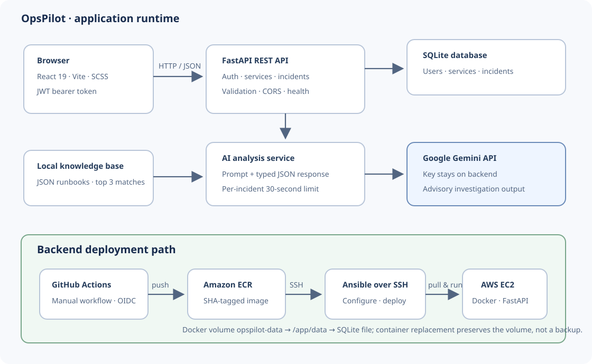

# OpsPilot — Product Requirements and Design

OpsPilot is a small incident and service-health application for microservice operations. Authenticated users can manage incidents and review service records; administrators can manage the service catalog. Responders can request advisory AI analysis enriched with locally stored troubleshooting knowledge.

The project is an understandable portfolio MVP, not a claim of production-scale monitoring. Service health is stored in the application; OpsPilot does not automatically poll external services or execute AI recommendations.

## Product requirements

| User | Need |
| --- | --- |
| Operations user | View services and create, filter, review, and update incidents. |
| Administrator | Create, edit, change status, and delete service records. |
| Incident responder | Get structured, advisory investigation suggestions for an incident. |

Core requirements:

- Register and log in with password hashing and bearer-token authentication.
- Require authentication for service and incident operations; restrict service mutations to administrators.
- Link every incident to an existing service. Support severity (`low`, `medium`, `high`, `critical`), status (`open`, `investigating`, `resolved`), filtering, and pagination.
- Generate readable `INC`-style incident numbers.
- Offer authenticated AI analysis when `GEMINI_API_KEY` is configured, returning a summary, possible root cause, recommended checks, suggested resolution, and whether knowledge was used.
- Provide a health endpoint and repeatable fictional seed data for local demos.

Out of scope: real external service monitoring, automatic incident resolution, autonomous infrastructure changes, vector/embedding search, high availability, and zero-downtime deployment.

**Security implementation caveat:** service mutations check for an admin role, but the current public registration request accepts a role value, including `admin`. Server-side role assignment must be restricted before exposing registration to untrusted users.

## Architecture and request flow

The React/Vite browser app calls the FastAPI JSON API. The frontend attaches a bearer token to protected requests. FastAPI routers validate requests and authorization, then use SQLAlchemy service modules and SQLite. Pydantic schemas define request and response data; CORS is limited by the configured `ALLOWED_ORIGINS`.

For AI analysis, the incident route loads the incident and its service, then the AI service checks configuration and rate limits, retrieves matching entries from `backend/app/knowledge/knowledge_base.json`, builds a prompt, and requests a structured response from Gemini. The API key remains on the backend. The result is shown as advice that responders must verify.

The Docker image packages the backend only. The frontend is a separate Vite static build. In a production frontend, `VITE_API_BASE_URL` is embedded when building; the backend CORS allowlist must include the frontend's exact browser origin.

## API and main workflows

Open `/docs` while the backend is running for the generated API schema. Protected routes require `Authorization: Bearer <token>`.

| Method and path | Access | Purpose |
| --- | --- | --- |
| `GET /`, `GET /health` | Public | App info and health check. |
| `POST /auth/register`, `POST /auth/login` | Public | Create an account or sign in; returns a token and user. |
| `POST /auth/logout` | Signed in | Frontend discards the token; there is no server-side revocation. |
| `GET /services`, `GET /services/{service_name}` | Signed in | List or read services. |
| `POST /services`, `PATCH`/`PUT /services/{service_name}`, `PATCH /services/{service_name}/status`, `DELETE /services/{service_name}` | Admin | Manage service records. |
| `POST /incidents`, `GET /incidents`, `GET /incidents/{incident_id}`, `PATCH /incidents/{incident_id}` | Signed in | Create, list, read, and update incidents. |
| `POST /incidents/{incident_id}/analyze` | Signed in | Generate AI analysis; returns `429` when rate limited. |

Incident listing accepts optional `service`, `severity`, and `status` filters, plus `page` and `page_size` (1–100; default 20). On the UI, registration/login leads to the dashboard; a responder selects an incident to review or update it, or request analysis if it is not resolved.

## Technical decisions and boundaries

- **FastAPI, Pydantic, and SQLAlchemy:** Keep request validation, route handling, and business/persistence logic in clear layers. Main code is under `backend/app/routes/`, `schemas/`, and `services/`.
- **React and Vite:** Provide a separate browser UI and portable static build. UI/API code is in `frontend/src/`; Vite embeds `VITE_API_BASE_URL` at build time.
- **SQLite:** Keeps local setup simple for a small demo. The AWS container uses a named volume at `/app/data`; volume persistence is not a backup or high-availability guarantee.
- **Local keyword retrieval:** `rag_service.py` matches incident tokens against curated JSON keywords and returns up to three entries. It is deterministic and easy to inspect, but is not semantic search.
- **Structured Gemini response:** `ai_service.py` asks for the Pydantic `AIIncidentAnalysis` shape and includes provider retries/model fallbacks. Generated output can still be wrong.
- **Rate limiting:** Analysis is limited per incident to one request per 30 seconds using in-process memory. It resets on restart and is not shared across workers.
- **Incident numbering:** The current implementation formats the maximum incident row ID plus one as `INC` followed by five digits. Do not claim it is concurrency-safe without additional sequence/locking guarantees.
- **Deployment:** GitHub Actions has automatic CI and a manually triggered AWS workflow. The manual workflow uses OIDC, pushes a SHA-tagged backend image to ECR, then uses SSH/Ansible to deploy on EC2. EC2 pulls using its instance profile. The workflow configuration alone does not verify live AWS operation.

## Verification

The October 12, 2026 local review recorded 60 backend tests passing and successful frontend build and lint. It did not verify live AWS resources, the deployed service, external frontend hosting, or browser-to-live-API behavior.

For a release, verify the workflow run and deployed image SHA, OIDC and ECR permissions, EC2/container health, `/health`, authenticated service/incident flows, the frontend API URL and CORS, and database persistence/backup behavior. See [deployment readiness](DEPLOYMENT_READINESS.md), [AWS deployment](AWS_DEPLOYMENT.md), [backend test results](BACKEND_TEST_RESULTS.md), and [frontend build results](FRONTEND_BUILD_RESULTS.md).
